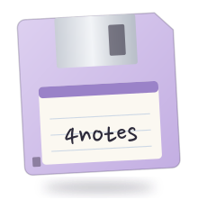
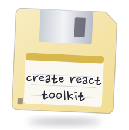
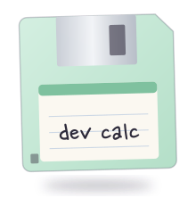
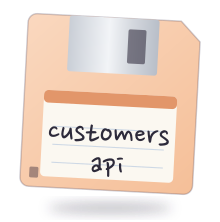
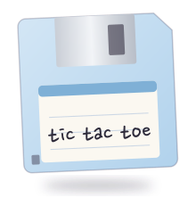
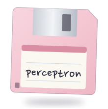

  

  <i>I've worked across the web, mobile, command-line tools and artificial intelligence. Now I'm stepping into game development.</i>

 

  

  
  
  
  
  
  

 

  

  
  
  
  
  
  

 

  

  
  
  
  
  
  

<table align="center">
  <tr><td><a href="https://github.com/4kauanmota/4notes-app"><b>4notes</b></a></td><td>Notes, tasks, mind maps, links and a timer in one app for Windows and Android. No login: everything stays in your own folder, as Markdown and JSON. · <a href="https://4notes-web.vercel.app/">download site</a></td></tr>
  <tr><td><a href="https://github.com/4kauanmota/create-react-toolkit-cli"><b>create react toolkit</b></a></td><td>A CLI that creates a React project already set up with TypeScript, Sass, Jest, Babel and React Router. Published on npm. · <a href="https://www.npmjs.com/package/create-react-toolkit">npm</a></td></tr>
  <tr><td><a href="https://github.com/4kauanmota/dev-calc-web"><b>dev calc</b></a></td><td>A calculator that speaks programming language syntax, like % for the remainder and ** for powers. Vue and Vuetify. · <a href="https://dev-calc-five.vercel.app/">live</a></td></tr>
  <tr><td><a href="https://github.com/4kauanmota/customers-api"><b>customers api</b></a></td><td>A REST API to create, list, update and delete customer records, with Fastify, Prisma and MongoDB, documented with Swagger.</td></tr>
  <tr><td><a href="https://github.com/4kauanmota/tic-tac-toe-web"><b>tic tac toe</b></a></td><td>Tic tac toe with a scoreboard and an opponent that thinks with the minimax algorithm.</td></tr>
  <tr><td><a href="https://github.com/4kauanmota/perceptron-ai"><b>perceptron</b></a></td><td>A perceptron that learns whether each point is above or below a line, written in JavaScript.</td></tr>
</table>

  

  

  
  
  
  

 

  

