

  <a href="https://4kauanmota.com.br"></a>

  <i>Big ideas move me. I like to explore what could exist, create with curiosity and keep building until a thought becomes something real, as big as it deserves to be.</i>

 

  <a href="https://4kauanmota.com.br"></a>

  <a href="https://4kauanmota.com.br"></a>
  <a href="https://4kauanmota.com.br"></a>
  <a href="https://4kauanmota.com.br"></a>
  <a href="https://4kauanmota.com.br"></a>
  <a href="https://4kauanmota.com.br"></a>

 

  <a href="https://4kauanmota.com.br"></a>

  <a href="https://4kauanmota.com.br"></a>
  <a href="https://4kauanmota.com.br"></a>
  <a href="https://4kauanmota.com.br"></a>
  <a href="https://4kauanmota.com.br"></a>
  <a href="https://4kauanmota.com.br"></a>
  <a href="https://4kauanmota.com.br"></a>

 

  <a href="https://4kauanmota.com.br"></a>

  
  
  
  

 

  <a href="https://4kauanmota.com.br"></a>

